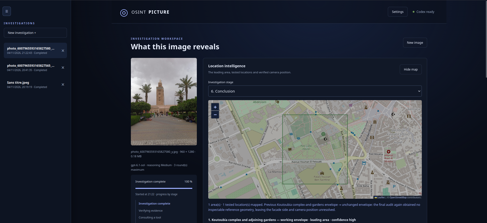
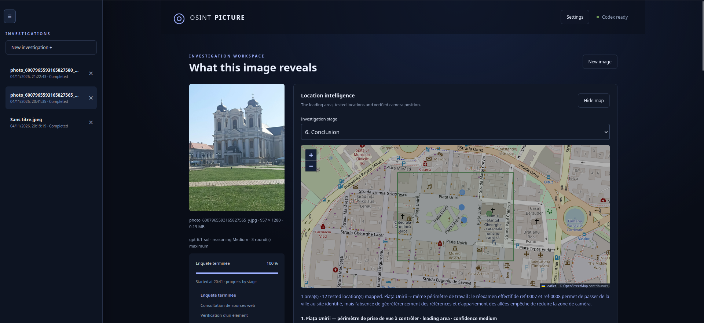

# Codex Find Place

A local app that helps locate where a photo was taken using visual clues, metadata, and web research. Explore candidate locations on a map and keep investigation reports on your computer.

## Quick install

Requirements: Node.js 22.12+ (or 20.19+), npm, Python 3.11+, [uv](https://docs.astral.sh/uv/), and Codex CLI installed and signed in (`codex login`).

From the project folder:

```sh
uv run codex-find-place
```

Open http://127.0.0.1:8000 and upload a photo. Codex uses your account; web research requires an Internet connection.

This single command installs frontend dependencies when needed, compiles the frontend and starts the application. After changing the frontend, stop the application and run the same command again.

For Street View research, install the browser once with `uv run playwright install chromium`.

## Location results

The result shows WGS84 **latitude, longitude** in decimal degrees. Click the coordinate pair to open that point in Google Maps, copy it, or centre the in-app map on it. The map keeps the leading result in view even when rejected candidates are far away.

Cyan identifies a camera position supported by the report's verification evidence. Amber identifies an estimated position, a photographed landmark, or an area centre. The reported uncertainty is shown in metres and drawn as a circle when available. Six displayed decimal places do not guarantee metre-level accuracy; unknown coordinates and uncertainty remain explicitly unknown. Earlier reports remain readable.

Observation, targeted web verification and the evidence audit run in the same model pass. Further passes follow concrete checks, concentrating on the photographer's viewpoint once a site is recognized. Photo searches overlap, reference photos and Street View are fetched concurrently, and failed Street View targets are not retried automatically. Research stops when the camera position is verified or no useful check remains. Actual latency and precision still depend on the photo and accessible sources.

## Examples





## Replacing the AI provider

The Codex adapter lives in `osint_picture/providers/codex.py`. To use another engine, implement the `Provider` contract in `osint_picture/providers/__init__.py`, then run `FIND_PLACE_PROVIDER=my_module:MyProvider uv run codex-find-place`. Its async `analyze` method receives the job, stage, instruction, and image paths, and returns a validated `Report`. The interface settings and connection diagnostics currently remain specific to Codex.
